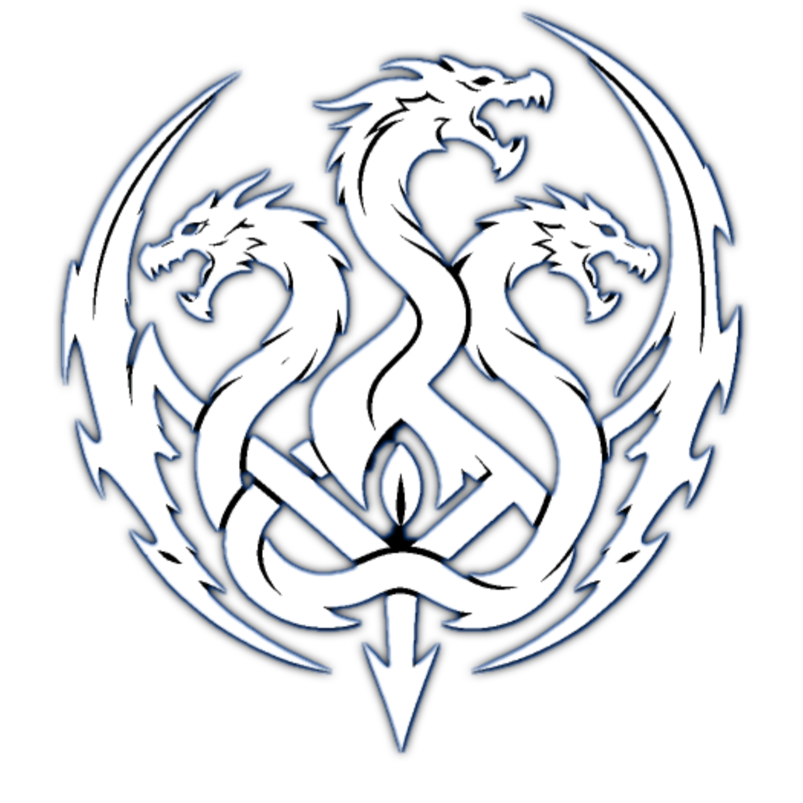

<p align="center">

</p>

<h1 align="center">HydraESP</h1>

<p align="center">
<b>A Wi-Fi + Bluetooth testing firmware for the ESP32</b><br/>
Deauth. Evil Twin. BLE spam. HID payloads. One $5 board, one web UI, no laptop required.
</p>

<p align="center">
<a href="https://github.com/SameerAlSahab/Hydra-ESP/actions"></a>
<a href="https://github.com/SameerAlSahab/Hydra-ESP/blob/main/LICENSE"></a>
<a href="https://github.com/SameerAlSahab/Hydra-ESP/stargazers"></a>
<a href="https://github.com/SameerAlSahab/Hydra-ESP/forks"></a>
<a href="https://github.com/SameerAlSahab/Hydra-ESP/issues"></a>
<a href="https://github.com/SameerAlSahab/Hydra-ESP/commits/main"></a>
</p>

<p align="center">
<a href="#features">Features</a> ·
<a href="#getting-started">Getting started</a> ·
<a href="#web-interface">Web UI</a> ·
<a href="#attacks">Attacks</a> ·
<a href="#bt-payload">BT Payload</a> ·
<a href="#building-it-yourself">Build</a> ·
<a href="CONTRIBUTING.md">Contributing</a>
</p>

<p align="center">


</p>


## About

HydraESP is a security research firmware for the ESP32 that turns a dev board into a portable Wi-Fi and Bluetooth test rig. It boots its own management AP, serves a full web interface off SPIFFS, and packs a dozen attack and detection modules into something that fits in your pocket. Built on top of risinek's esp32-wifi-penetration-tool, extended far past the original scope.

> [!WARNING]
> Educational security research tool. Run it only against networks and devices you own or have explicit written permission to test. Unauthorised use is illegal under the CFAA (US), Computer Misuse Act (UK), IT Act 2000 (BD/IN) and equivalent laws basically everywhere. The authors accept no liability for misuse.

## Features

| Module | What it actually does |
| --- | --- |
| **Deauthentication** | Raw 802.11 deauth frames against up to 16 targets. Four methods: Normal, Combined (deauth + disassoc), Multi-Clone, and BSSID Clone (Aggressive), which clones SSID and BSSID so clients drop even on 802.11w/MFP. |
| **WPA Handshake Capture** | Forces reconnects, captures the WPA2 4-way handshake, saves `.pcap` + `.hccapx` for Hashcat/aircrack-ng. Normal, BSSID Clone, or Silent (pure sniffing) modes. |
| **Clientless PMKID Capture** | Pulls the PMKID from the first EAPOL-Key frame. No client needed, works with Hashcat mode 22000. |
| **Evil Twin ("Devil Twin")** | Open clone of the target AP + live deauth of the real one, DNS captive portal, and real password verification: submitted passwords are actually tried against the real AP before being marked captured. |
| **Super Clone** | Spawns multiple near-identical SSIDs (space-padded names) so the scan list fills with copies of one network. |
| **Beacon Spam** | 1–100 fake networks. Common names, random strings, Rick Roll mode, or security-gear-styled SSIDs. |
| **Ghost Mode** | Sniffs probe requests, learns which SSIDs devices are hunting for, then advertises those exact names back. |
| **BLE Spam** | 25 modes of Apple/Samsung/Google proximity-pairing spam. Rotates MAC every run. |
| **BT Payload** | Bluetooth HID keyboard with five keystroke-injection payloads (see below). |
| **Deauth Attack Detector** | Promiscuous-mode monitor that flags 10+ deauth frames/second from one BSSID, plus broadcast deauth. Live log in the web UI. |
| **OLED support** | Optional SSD1306 128x64 I2C display: timers, status, menu, captured Evil Twin passwords. Auto-detected, silently skipped if absent. |


## Hardware

**Required**

- ESP32 DevKit V1, or any board on the same ESP32 (Xtensa LX6 dual-core) SoC. WROOM-32 / WROVER work. S2 and C3 are **not** supported (different radio).
- S3: see the S3 branch. No longer maintained, but PRs are welcome.

**Optional**

- SSD1306 OLED (128x64, I2C) for on-device status. Everything below also works through the web UI without it.

## Getting started

Flash the latest release (or build it yourself below), power the board, and connect to its AP:

| Field | Default |
| --- | --- |
| SSID | `hydra` |
| Password | `notforfun` |
| Web UI | `http://192.168.4.1` |

Change the credentials from **Settings**; they persist in NVS flash across reboots.

> [!NOTE]
> Some attacks (Deauth, Evil Twin, Super Clone) need the radio to themselves. The management AP drops while they run, so the web UI disconnects. Set a timeout and it comes back on its own; with no timeout set you power cycle to stop the attack.


## Web interface

Served straight off SPIFFS at `http://192.168.4.1`.

- **Scan**,  nearby networks with SSID/BSSID/signal. Tap a row to target it.
- **Attack**,  pick and launch any module, watch live status, timers and results.
- **Detector**,  start/stop the deauth monitor, read the alert log.
- **Settings**,  change AP SSID/password (reboots on save).
- **About**,  firmware version, credits, legal notice.

## Usage

1. Power the board, join the `hydra` AP with password `notforfun`.
2. Open `http://192.168.4.1`.
3. **Scan**, tap a target network.
4. **Attack** tab: pick a module and method, set a timeout, launch.
5. Watch live status and results on the same page. Captured handshakes, PMKIDs and Evil Twin passwords appear in the results view and on the OLED if one is attached.

Radio-exclusive attacks (Deauth, Evil Twin, Super Clone) drop the management AP for their duration. Everything else keeps the web UI live.

## Attacks

Full per-module docs live in the sections above and in the code (`main/`). Quick map of method choices per module:

| Module | Methods / modes |
| --- | --- |
| Deauth | Normal / Combined / Multi-Clone / BSSID Clone (Aggressive) |
| WPA Handshake | Normal Deauth / BSSID Clone / Silent Capture |
| Evil Twin | fixed (portal + verification) |
| Beacon Spam | Common Names / Random Strings / Rick Roll / Security Names |
| BLE Spam | 25 modes: Apple Audio (8), Apple Setup (5), Samsung (6), Google (5), Mixed Random |

Default timeouts: Deauth 2 min, most Wi-Fi spam modules 5 min, BLE Spam 15 min. Every timeout can be disabled, at the cost of needing a power cycle to stop.


## BT Payload

The ESP32 advertises itself as a Bluetooth HID keyboard (`HydraBT-XXXX`, fresh random MAC each run). Pair from Android with something like nRF Connect, then fire a payload from the Attack tab:

| Payload | Effect |
| --- | --- |
| Write to Notepad | Opens Notepad and types a message. The hello world. |
| Play Rick Roll | Opens the browser to a YouTube link. You can guess which. |
| Set Warning Wallpaper | Downloads an image and sets it as the desktop wallpaper. Target must be online. |
| Grab Wi-Fi Passwords | Reads saved Wi-Fi profiles and POSTs them to the ESP32 log endpoint (or your custom URL / RequestBin). |
| Hydra God Mode | The bundled prank script: wallpaper swap + sound. |

**Writing your own payload:** each payload is a small function (`do_notepad_sequence`, `do_payload_2`..`do_payload_5`) in `bt_payload_attack.cpp` that presses keys through `s_keyboard`. Add a `case N:` in `execute_current_payload()`, a button in `data/index.html` + `data/app.js`, and drop any script the payload needs to pull into `/payloads`. PRs welcome, see CONTRIBUTING.md.

## Building it yourself

Prerequisite: [ESP-IDF](https://docs.espressif.com/projects/esp-idf/en/latest/esp32/get-started/) set up for the standard ESP32 target.

```bash
git clone https://github.com/SameerAlSahab/Hydra-ESP.git
cd Hydra-ESP
idf.py set-target esp32
idf.py build
idf.py -p /dev/ttyUSB0 flash monitor
```

The web UI assets in `data/` go to SPIFFS separately. Check `partitions.csv` and use your IDF version's SPIFFS flashing step.

## I forgot new WiFi name and Password

If you forgot newly added name and password after changing it, you need to clear the nvs memory to delete it

<code>idf.py erase-flash</code>


### Dependencies

| Library | License |
| --- | --- |
| u8g2-hal-esp-idf | See repo |
| ESP32-BLE-Keyboard | See repo |
| u8g2 | BSD 2-Clause |
| esp-nimble-cpp | Apache 2.0 |


## Citation

A paper (`paper/hydra_esp_paper.pdf`) walks through the 802.11/BLE background of every module above: how each attack works at the protocol level and the countermeasures that fix the root cause (802.11w, WPA3-SAE, rogue-AP detection, tighter BT pairing). Use the `CITATION.cff` in this repo (GitHub's "Cite this repository" button picks it up) or:

```bibtex
@article{alsahab2026hydraesp,
  author  = {Al Sahab, Sameer},
  title   = {Low-Cost IEEE 802.11 and Bluetooth Attack Surfaces on Commodity Microcontrollers: A Case Study of the ESP32 Platform},
  year    = {2026},
  url     = {https://github.com/SameerAlSahab/Hydra-ESP/blob/main/paper/hydra_esp_paper.pdf},
  note    = {Firmware and paper available in this repository.}
}
```

## Contributing

Bugs, ideas, new modules: see CONTRIBUTING.md. "Does this work on X board" questions belong in Discussions, not Issues.

## Credits

| Role | Name |
| --- | --- |
| Lead developer | Sameer Al Sahab |
| Original codebase | risinek |
| Inspiration | spacehuhn |
| BLE spam code | justcallmekoko and ckcr4lyf |

## Star history

<a href="https://star-history.com/#SameerAlSahab/Hydra-ESP&Date">
<picture>
<source media="(prefers-color-scheme: dark)" srcset="https://api.star-history.com/svg?repos=SameerAlSahab/Hydra-ESP&type=Date&theme=dark" />
<source media="(prefers-color-scheme: light)" srcset="https://api.star-history.com/svg?repos=SameerAlSahab/Hydra-ESP&type=Date" />

</picture>
</a>

## Contributors

<a href="https://github.com/SameerAlSahab/Hydra-ESP/graphs/contributors">

</a>


## License

GPL-3.0. See [LICENSE](LICENSE). Bundled third-party components (u8g2, ESP32-BLE-Keyboard, esp-nimble-cpp) keep their own licenses, listed in the Dependencies table above.

